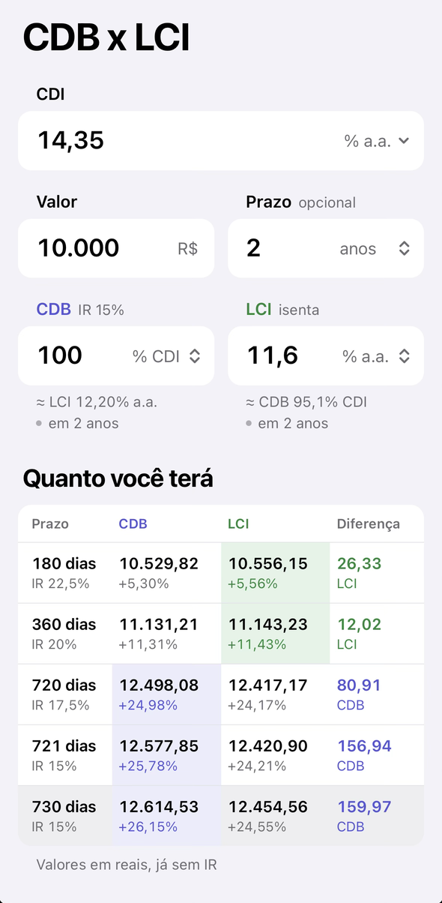
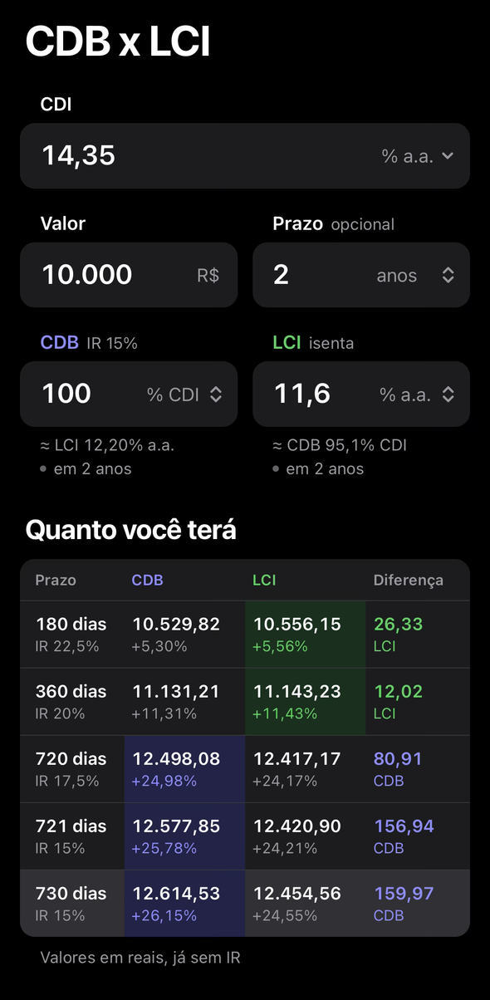

# CDB x LCI


Calculadora para iPhone que compara um CDB com uma LCI e mostra qual rende mais em cada prazo, já com o imposto de renda descontado.

Funciona como app na tela inicial (PWA), offline, e guarda os últimos valores no próprio aparelho.

## O que o app mostra

- **Taxas** do CDB e da LCI em % do CDI ou em % ao ano, cada uma com sua unidade. Dá para comparar, por exemplo, um CDB de 110% do CDI com uma LCI de 12% a.a.
- **Equivalentes**: embaixo de cada taxa, quanto o outro investimento precisa pagar para empatar. Sem prazo, usa o melhor caso do CDB (IR de 15%).
- **Tabela** com o valor final, o rendimento líquido e a diferença no último dia de cada faixa de IR, mais uma linha para o prazo digitado, em dias, meses ou anos.
- **CDI por ano**: a seta no campo CDI abre um gráfico com o ano atual e os seguintes. Arrastar as barras muda o CDI de cada ano, e a tabela recalcula com esses valores.

## Telas

<p align="center">
  
  &nbsp;
  
</p>

## Como o cálculo funciona

O IR do CDB é cobrado uma vez, no resgate, sobre todo o lucro, com a alíquota do tempo total aplicado:

| Dias corridos | IR |
|---|---|
| até 180 | 22,5% |
| 181 a 360 | 20% |
| 361 a 720 | 17,5% |
| 721 ou mais | 15% |

A LCI é isenta. O rendimento é composto por ano civil a partir da data de hoje, cada trecho com o CDI do seu ano. Meses e anos viram dias corridos (6 meses = 183 dias).

Simplificações: a taxa em % do CDI é aplicada sobre o CDI anual, os dias são corridos sobre 365 (os bancos usam dias úteis sobre 252) e o IOF de resgates com menos de 30 dias não entra.

## Instalar no iPhone

1. Abra o endereço do app no Safari.
2. Toque em Compartilhar e depois em **Adicionar à Tela de Início**.

Depois da primeira abertura, o app funciona sem internet. Versões novas são baixadas sozinhas quando o app é aberto.

## Desenvolvimento

```bash
npm install
npm run dev       # servidor local
npm test          # testes do cálculo
npm run build     # verificação de tipos e build com service worker
npm run icons     # gera os ícones em public/icons
```

Feito com Vite e TypeScript, sem framework. O cálculo fica em `src/calc.ts` e a tela em `src/main.ts`. O deploy é feito pela Vercel a cada push no `main`.
